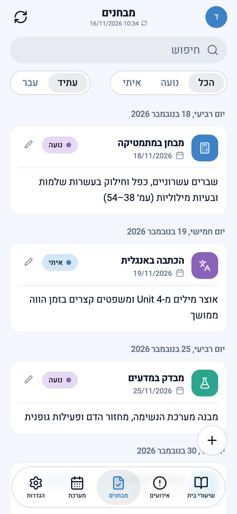
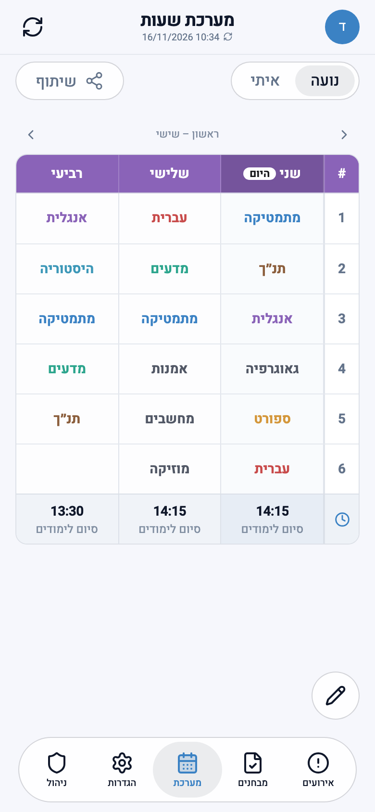

# School 🏫🎒


[](https://github.com/dmatik/school/releases/latest)

**School** (בית הספר) is a self-hosted Progressive Web App (PWA) for parents and students to track homework assignments, school incidents, exams and grades, and weekly schedules—synced directly from the Israeli **Webtop** (SmartSchool) portal.

> 🌐 **Bilingual First:** Fully localized in **Hebrew (RTL, default)** and **English (LTR)** with instant language switching.

---

## 📱 Mobile Screenshots

| Homework (שיעורי בית) | Incidents (אירועי משמעת) | Exams (מבחנים) | Schedule (מערכת שעות) |
| :---: | :---: | :---: | :---: |
|  |  |  |  |

---

## ✨ Key Features

* **📚 Homework & Assignments:** Live Webtop sync with smart consolidation of duplicate same-day lessons, automatic subject classification, search, and date filtering.
* **🚨 School Incidents & Attendance:** Track disciplinary events, positive teacher commendations, attendance, and tardiness with child and date filtering.
* **📝 Exams & Grades:** Upcoming and past exam timelines with parent-managed scheduling, study topics, and grade recording.
* **🗓️ Weekly Schedule:** Sunday–Friday timetable with daily dismissal times, batch edit mode, PDF sharing, and per-child color accents.
* **⚙️ Webtop Integration & Auto-Sync:** Centralized family Webtop connector with **AES-256-GCM** encrypted credentials at rest, automatic background sync (production only, with quiet hours and circuit-breaker backoff), and one-touch manual sync.
* **👨‍👩‍👧‍👦 Family & Role-Based Access:** Shared family data model with **Admin / User** system roles and **Parent / Child** family roles (students see a private, read-only view scoped to their own data).
* **🔑 Security & Passkeys:** Passwordless WebAuthn biometric login (Face ID, Touch ID, Windows Hello, hardware keys), JWT sessions with `token_version` revocation, bcrypt password hashing, and route rate limiting.

---

## 🛠️ Tech Stack

| Layer | Technologies |
| :--- | :--- |
| **Frontend** | **React 19** + **TypeScript 6** + **Vite 7** |
| **UI & Styling** | **Radix UI Primitives** + **Tailwind CSS 3.4** + **Storybook 10** + **Lucide React** |
| **Localization & Dates** | **i18next** (`he` / `en`) + **`date-fns` v3** |
| **Backend & Database** | **Express 5** + **Better-SQLite3** (`school.db` in WAL mode) |
| **Security & Auth** | **@simplewebauthn** + **JWT** + **Bcrypt** + **AES-256-GCM** |
| **Container & CI** | **Docker** (Alpine) + **GitHub Actions** |

---

## 🚀 Getting Started

### Default Administrator Credentials
Upon first database initialization, a default administrator account is seeded automatically:
* **Username:** `admin`
* **Password:** `admin`

> 💡 *Update the default password or register a biometric passkey immediately via the **Account** tab.*

---

### Option A: Docker Compose (Recommended) 🐳

1. Create a `docker-compose.yml` file:

```yaml
services:
  school:
    image: dmatik/school:latest
    container_name: school
    restart: always
    network_mode: bridge
    ports:
      - "5173:5173"
    environment:
      - LOG_LEVEL=${LOG_LEVEL:-errors}
    volumes:
      - ./data:/app/data
```

2. Start the container:
```bash
docker compose up -d
```

3. Open your browser at `http://localhost:5173` (or your server's IP / domain).

---

### Option B: Local Development 💻

1. **Clone the repository:**
   ```bash
   git clone https://github.com/dmatik/school.git
   cd school
   ```

2. **Install dependencies:**
   ```bash
   npm install
   ```

3. **Start backend API & frontend dev server:**
   ```bash
   npm run dev:all
   ```
   *This concurrently boots the Express 5 backend (port `3001`) and Vite dev server (port `5173`).*

4. **Open your browser:**
   Navigate to `http://localhost:5173`

---

## ⚙️ Environment Variables

All variables are optional with sensible defaults:

| Variable | Description | Default |
| :--- | :--- | :--- |
| `PORT` | Port the Express server listens on | `3001` (dev) / `5173` (Docker) |
| `NODE_ENV` | Application environment (`development` / `production`) | `development` |
| `JWT_SECRET` | Secret key for signing JWT tokens | Auto-generated & persisted in SQLite `settings` table |
| `ENCRYPTION_KEY` | Secret key for AES-256-GCM Webtop credential encryption | Auto-generated & persisted in SQLite `settings` table |
| `WEBTOP_AUTO_SYNC` | Production-only kill switch for automatic Webtop sync (`off` to disable; dev/test are always manual) | Enabled when `NODE_ENV=production` |
| `LOG_LEVEL` | Server logging (`Asia/Jerusalem` timestamps): `errors` or `all` | `errors` |
| `RP_ID` | Relying Party ID for WebAuthn passkeys | Auto-detected from hostname / forwarded host |
| `EXPECTED_ORIGIN` | Comma-separated allowed WebAuthn origins | Auto-detected from request `Origin` and `Host` |
| `TRUST_PROXY` | Trust reverse proxy headers (`x-forwarded-host`, `x-forwarded-proto`) | `false` (set `true` or `1` behind Nginx/Caddy/Cloudflare) |

---

## 📖 Storybook Component Catalog

All shared UI components in `src/components/ui/` are documented in **Storybook 10** (`src/stories/`), organized into four categories:
1. **Fields & Inputs** (`Input`, `SearchInput`, `Textarea`, `Select`, `DatePicker`, `Calendar`, `Switch`)
2. **Buttons & Navigation** (`Button`, `SyncButton`, `ActionButton`, `LogoutButton`, `FloatingActionButton`, `LiquidTabs`, `PullToRefresh`, `Navigation Shell`)
3. **Badges & Pickers** (`ChildBadge`, `SubjectIconBadge`, `StatusBadge`, `DateBadge`, `ColorSwatchPicker`, `UserAvatar`)
4. **Surfaces & Cards** (`Card`, `SectionCard`, `NoticeBanner`, `InfoBox`, `HomeworkCard`, `IncidentCard`, `ExamCard`, `ScheduleTable`, `AdminUserRow`, `EmptyStateCard`, `Modal`, `Login`)

The Storybook toolbar includes live toggles for **Hebrew (RTL) / English (LTR)** and **Light / Dark mode**.

```bash
# Start interactive Storybook dev server on http://localhost:6006
npm run storybook

# Build static Storybook site
npm run build-storybook
```

---

## 🧪 Verification, Testing & Screenshots

```bash
# 1. Typecheck and Production Build
npm run build

# 2. Linting
npm run lint

# 3. Unit & Component Tests (Vitest in happy-dom)
npm test

# 4. Local End-to-End Tests (Playwright)
npm run test:e2e

# 5. Regenerate README mobile screenshots using synthetic mock data (Playwright)
npm run screenshots
```

---

## 📄 License

This project is licensed under the MIT License - see the [LICENSE](LICENSE) file for details.

Made with ❤️ by [dmatik](https://github.com/dmatik)
