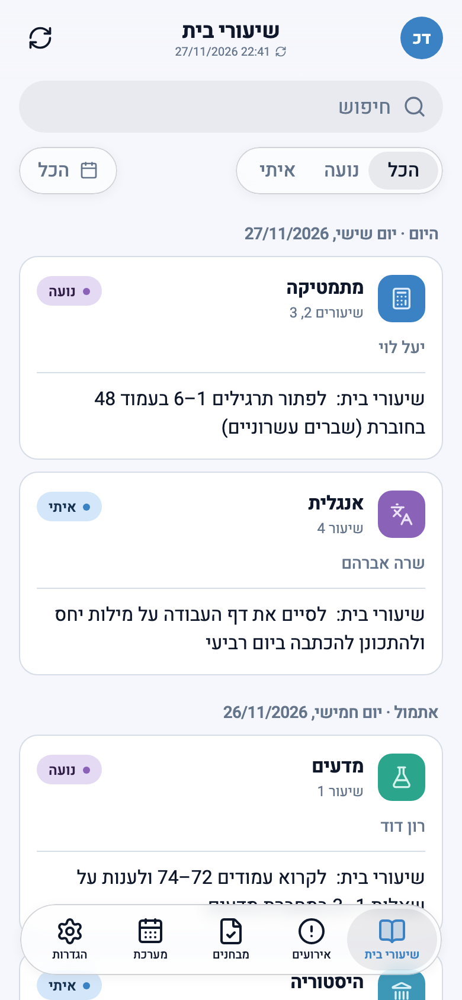
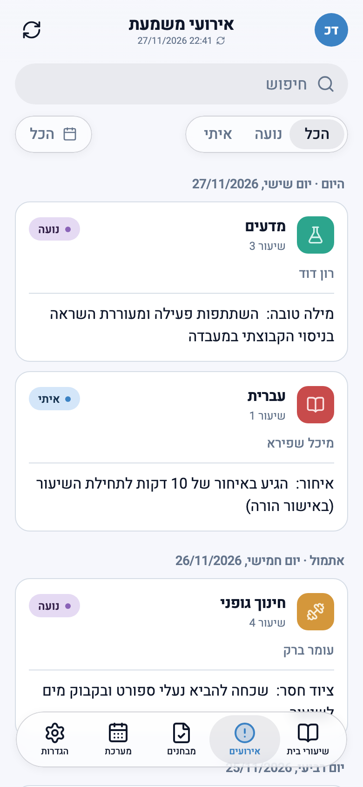

# School 🏫🎒


[](https://github.com/dmatik/school/releases/latest)

**School** (בית הספר) is a self-hosted cross-platform app (**Web, iOS & Android**) built with **Expo** and **Express 5** for parents and students to track homework assignments, school incidents, exams and grades, and weekly schedules—synced directly from the Israeli **Webtop** (SmartSchool) portal.

> 🌐 **Bilingual First:** Fully localized in **Hebrew (RTL, default)** and **English (LTR)** with instant language switching and light/dark themes.

---

## 📱 Screenshots

| Homework (שיעורי בית) | Incidents (אירועי משמעת) | Exams (מבחנים) | Schedule (מערכת שעות) |
| :---: | :---: | :---: | :---: |
|  |  |  |  |

---

## ✨ Key Features

* **📚 Homework & Assignments:** Live Webtop sync with smart consolidation of duplicate same-day lessons, automatic subject classification, search, and date filtering.
* **🚨 School Incidents & Attendance:** Track disciplinary events, positive teacher commendations, attendance, and tardiness with child and date filtering.
* **📝 Exams & Grades:** Upcoming and past exam timelines with parent-managed scheduling, study topics, and grade recording.
* **🗓️ Weekly Schedule:** Sunday–Friday timetable with daily dismissal times, batch edit mode, shared landscape PDF export/sharing across web and mobile, and per-child color accents.
* **⚙️ Webtop Integration & Auto-Sync:** Centralized family Webtop connector with **AES-256-GCM** encrypted credentials at rest, automatic background sync (production only, with quiet hours and circuit-breaker backoff), and one-touch manual sync.
* **👨‍👩‍👧‍👦 Family & Role-Based Access:** Shared family data model with **Admin / User** system roles and **Parent / Child** family roles (students see a private, read-only view scoped to their own data).
* **🔑 Security & Passkeys:** Passwordless WebAuthn biometric login (Face ID, Touch ID, Windows Hello, hardware keys), JWT sessions with `token_version` revocation, bcrypt password hashing, and route rate limiting.

---

## 🛠️ Tech Stack

| Layer | Technologies |
| :--- | :--- |
| **Client (Web, iOS & Android)** | **Expo 58** + **React Native 0.88** + **React 19** + **TypeScript 6** (`expo export -p web` co-hosted by Express) |
| **UI & Styling** | **React Native** + **React Native Web** + **Reanimated 4** + **Lucide React Native** + **React Native Storybook** |
| **Localization & Dates** | **i18next** (`he` / `en`) + **`date-fns` v4** |
| **Backend & Database** | **Express 5** + **Better-SQLite3** (`data/school.db` in WAL mode) |
| **Security & Auth** | **@simplewebauthn** + **JWT** + **Bcrypt** + **AES-256-GCM** + **Expo SecureStore** |
| **Testing** | **Jest** (`ts-jest` for server + `jest-expo` for app/web) in CI; **Playwright** (Web E2E) & **Maestro** (Mobile E2E) locally |
| **Container & CI** | **Docker** (Alpine) + **GitHub Actions** |

---

## 📁 Project Structure

```text
school/
├── app/                     # Unified Expo app (Web, iOS & Android)
│   ├── src/screens/         # Homework, Incidents, Exams, Schedule, Settings, Admin, Account, Login
│   ├── src/components/ui/   # Shared cross-platform UI components
│   ├── src/stories/         # React Native Storybook component catalog
│   ├── __tests__/           # Jest (jest-expo) unit & component tests
│   └── .maestro/            # Local Maestro mobile E2E flows
├── shared/                  # Shared types, locales (he.json/en.json), palettes, PDF & WebAuthn helpers
├── server/                  # Express 5 API + Better-SQLite3 DB + co-hosted static serving of app/dist
│   └── __tests__/           # Jest Node ESM backend & shared-module tests
├── e2e/                     # Local Playwright E2E tests against co-hosted Expo Web + ephemeral SQLite DB
├── scripts/                 # Screenshot generation script (Playwright against app/dist)
└── data/                    # Persistent SQLite database directory
```

---

## 🚀 Getting Started

### Default Administrator Credentials
Upon first database initialization, a default administrator account is seeded automatically:
* **Username:** `admin`
* **Password:** `admin`

> 💡 *Update the default password or register a biometric passkey immediately via the **Account** tab.*

---

### Option A: Docker Compose (Recommended) 🐳

1. Create a `docker-compose.yml` file:

```yaml
services:
  school:
    image: dmatik/school:latest
    container_name: school
    restart: always
    network_mode: bridge
    ports:
      - "5173:5173"
    environment:
      - LOG_LEVEL=${LOG_LEVEL:-errors}
    volumes:
      - ./data:/app/data
```

2. Start the container:
```bash
docker compose up -d
```

3. Open your browser at `http://localhost:5173` (or your server's IP / domain).

---

### Option B: Local Development (Web + Backend) 💻

1. **Clone the repository:**
   ```bash
   git clone https://github.com/dmatik/school.git
   cd school
   ```

2. **Install dependencies (root + Expo app):**
   ```bash
   npm install
   npm --prefix app install
   ```

3. **Start backend API & Expo Web dev server:**
   ```bash
   npm run dev:all
   ```
   *This concurrently boots the Express 5 backend (port `3001`) and Expo Web dev server (port `8081`). Open `http://localhost:8081` in your browser.*

4. **Or run the production co-hosted build locally:**
   ```bash
   npm run build
   npm run server
   ```
   *Navigate to `http://localhost:3001`.*

---

### Option C: Native Mobile App (iOS & Android) 📱

The `app/` workspace builds the native **Expo / React Native** app from the exact same codebase as Web.

1. **Run on iOS, Android, Expo Go, or Storybook:**
   ```bash
   # From the repository root:
   npm run app:ios       # Build & launch on iOS simulator/device
   npm run app:android   # Build & launch on Android emulator/device
   npm run app:go        # Start Expo Go bundler
   npm run app:start     # Start Expo dev client bundler
   npm run app:storybook # Start React Native Storybook (port 8082)
   ```

2. **Connect to your server:**
   Enter your self-hosted **School** server URL on the mobile login screen (saved securely with `expo-secure-store`). When running on co-hosted Web, the server URL is detected automatically.

---

## ⚙️ Environment Variables

All variables are optional with sensible defaults:

| Variable | Description | Default |
| :--- | :--- | :--- |
| `PORT` | Port the Express server listens on | `3001` (dev) / `5173` (Docker) |
| `NODE_ENV` | Application environment (`development` / `production`) | `development` |
| `JWT_SECRET` | Secret key for signing JWT tokens | Auto-generated & persisted in SQLite `settings` table |
| `ENCRYPTION_KEY` | Secret key for AES-256-GCM Webtop credential encryption | Auto-generated & persisted in SQLite `settings` table |
| `WEBTOP_AUTO_SYNC` | Production-only kill switch for automatic Webtop sync (`off` to disable; dev/test are always manual) | Enabled when `NODE_ENV=production` |
| `LOG_LEVEL` | Server logging (`Asia/Jerusalem` timestamps): `errors` or `all` | `errors` |
| `RP_ID` | Relying Party ID for WebAuthn passkeys | Auto-detected from hostname / forwarded host |
| `EXPECTED_ORIGIN` | Comma-separated allowed WebAuthn origins | Auto-detected from request `Origin` and `Host` |
| `TRUST_PROXY` | Trust reverse proxy headers (`x-forwarded-host`, `x-forwarded-proto`) | `false` (set `true` or `1` behind Nginx/Caddy/Cloudflare) |

---

## 📖 Storybook Component Catalog

All shared UI components in `app/src/components/ui/` are documented in **React Native Storybook** (`app/src/stories/`), with live toggles for **Hebrew (RTL) / English (LTR)** and **Light / Dark mode**:

```bash
# Start React Native Storybook bundler on port 8082
npm run app:storybook
```

---

## 🧪 Verification, Testing & Screenshots

```bash
# 1. Typecheck (root shared/e2e + Expo app)
npm run typecheck

# 2. Linting (root + Expo app)
npm run lint

# 3. Unit & Component Tests (Jest: server + app/web — runs in CI)
npm test
npm run test:server   # Backend & shared-module Jest tests only
npm run test:web      # Expo UI/web Jest tests only

# 4. Production Web Build (exports Expo Web to app/dist)
npm run build

# 5. Local End-to-End Tests (Playwright against co-hosted Expo Web + ephemeral SQLite DB)
npm run test:e2e

# 6. Local Mobile End-to-End Tests (Maestro iOS / Android)
npm run test:maestro
npm run test:maestro:android

# 7. Regenerate README screenshots from Expo Web using synthetic mock data
npm run screenshots
```

---

## 📄 License

This project is licensed under the MIT License - see the [LICENSE](LICENSE) file for details.

Made with ❤️ by [dmatik](https://github.com/dmatik)
